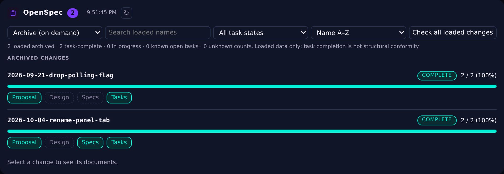
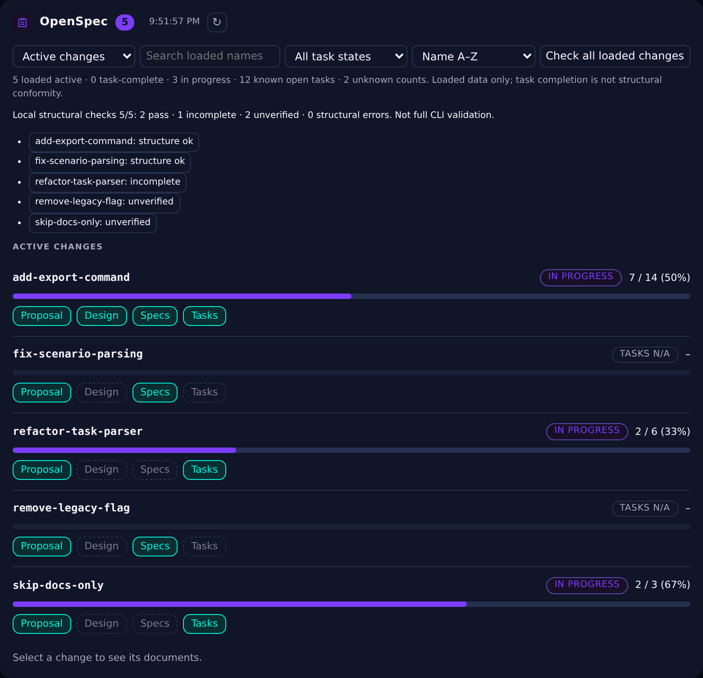

# pi-openspec-status

A small, read-only **OpenSpec panel for PI WEB**. It adds an **OpenSpec** tab to the workspace view, so you can check what is in progress without opening every Markdown file.

## Screenshots

All images come from the bundled synthetic fixtures, rendered by the real plugin inside a
Chromium page with PI WEB's own theme: no real project, path, session or host appears in them.


*Active changes: search, task-state/artifact filters, deterministic sorting, an operational
summary and per-change progress. Artifact chips show presence, not validity.*


*Change detail: Proposal/Design/Specs/Tasks tabs, task filters (all / to complete / completed)
and collapsible task sections. Task completion is not structural conformity.*



*Archive mode loads `openspec/changes/archive/` only when you ask for it; the ordinary poll
never walks archive contents.*



***Check all loaded changes*** reports one verdict per change (structure ok / incomplete /
unverified / structural error) and states plainly that this is not full CLI validation.

## What you get

- **Loaded changes:** instant name search, task-state/artifact filters and deterministic sorting (name, progress or open tasks). Unknown counts always sort last. No file requests while typing.
- **Compact operational summary:** loaded changes, task-complete/in-progress changes, known open tasks and unknown counts. Completion is not structural conformity.
- **Document viewer:** read Markdown, browse specs and filter tasks (all / to complete / completed), with collapsible sections. Selection, filters, section expansion, keyboard focus and scroll survive compatible refreshes.
- **On-demand archive:** browse archived changes and documents separately; arbitrary directory names are supported. The ordinary poll never walks archive contents.
- **Updates:** refresh manually, react to file changes reported by PI WEB, or check for edits made in an external editor or terminal every 60 seconds while the panel is active.
- **Navigation:** open a document in PI WEB's Files tab and return to the same change and document.
- **Local structural diagnostics:** each loaded change carries a badge (structure ok / incomplete / unverified / structural error); select one to read its reasons and warnings, or explicitly **Check all loaded changes** for a batch run with progress/results, the ability to stop scheduling further checks and to jump to a result. This is **not** `openspec validate`; incomplete, unreadable or unsupported inputs remain unverified.

The plugin only reads workspace files through PI WEB's file API. It does not modify projects, run the OpenSpec CLI or require a model or runtime dependencies.

## Install

Verified with **PI WEB 1.202611.1** (plugin API v5): isolated real-shell GUI tests on Cristina use actual host discovery/file/navigation APIs and synthetic projects. Separate Chromium harness tests still use simulated host APIs. See [consolidation evidence](docs/CONSOLIDATION.md) for coverage and remaining limits. The workspace needs an `openspec/changes/` directory.

**From npm** (recommended). In PI WEB open **Settings → Pi packages**, enter
`npm:pi-openspec-status-web` and choose **Install**. Then open **Settings → PI WEB plugins**,
make sure the plugin is enabled, and reload the browser page. It is a browser-only plugin,
so no session-daemon restart is needed. From a terminal on the same machine the equivalent is
`pi install npm:pi-openspec-status-web`.

**From a GitHub checkout** (alternative), from the directory where you want to clone it:

```bash
git clone https://github.com/diniket/pi-openspec-status.git
mkdir -p ~/.pi-web/plugins
ln -s "$(pwd)/pi-openspec-status" ~/.pi-web/plugins/pi-openspec-status
```

Reload PI WEB and select the **OpenSpec** tab in a workspace.

For managed production, prefer a verified immutable package release rather than a writable Git
checkout. The [PUCP integration](docs/PUCP-INTEGRATION.md) uses verified immutable releases and a
baseline rollback; never repoint an installed development checkout to test a feature. Develop in a separate worktree.

The built plugin is already included in `dist/`, in the npm tarball as well as in the
repository; you do not need to install dependencies or build it to use it. The package is
tagged `pi-web.dev-plugin`, `pi-web-plugin` and `pi-package`, so it is listed in the
[PI WEB community plugins directory](https://pi-web.dev/community-plugins).

## Notes

- Each collection shows at most **40 changes**, chosen by deterministic name order, and **12 spec files / capability folders per detail**. Search, sorting and metrics concern **loaded data only**, never the entire project when listings are partial. The host itself caps directory listings at 1,000 entries and has no pagination API.
- Not started includes known zero-item files; task-complete requires at least one task. Missing, binary, truncated or unreadable tasks have **unknown counts**, not zero. The artifact filter includes optional Design: it is not a validity verdict.
- Archive loading is explicit (including after restoring an archive navigation link). Use Refresh or host invalidation for archive updates; only the existing archive-directory count in the no-active view is polled.
- Requests have a 15-second end-to-end timeout, including queue wait, and scans a 60-second deadline; the host receives an AbortSignal. Six host calls maximum per workspace, two batch change workers. Stop prevents new changes and subsequent validation reads; a shared in-flight detail/read can finish (bounded by timeout), so another consumer is never cancelled.
- A timed-out host that ignores AbortSignal may keep its own transport alive; the plugin still settles the Promise, releases UI busy state and handles late responses/rejections. No backend can be forcibly cancelled by a browser-only plugin.
- The structure badge is only a quick check of the files the panel can read. For full validation, use the OpenSpec CLI.
- In PI WEB 1.202611.0, opening a bookmarked URL containing `tool=openspec-status:openspec-status` can show **Workspace panel unavailable** during startup. Opening the workspace first and clicking **OpenSpec** works around this host-side issue.

## Development

```bash
npm test            # Node regression tests
npm run build       # copy src/pi-web-plugin.js to dist/
npm run benchmark   # synthetic polling latency/concurrency (5ms per host call)
```

The source is in `src/pi-web-plugin.js`; `dist/pi-web-plugin.js` must stay identical. See [development notes](docs/DEVELOPMENT.md) for internals.

The README screenshots are produced by rendering that same `dist` build in Chromium over a
synthetic fixture: [`scripts/panel-screenshot-harness.mjs`](scripts/panel-screenshot-harness.mjs)
builds the page and documents how to capture it.

Short [Pi Agent operational guide](docs/AGENT-OPERATIONS.md), [release procedure](docs/RELEASE.md),
[changelog](CHANGELOG.md), [second independent review](docs/SECOND-REVIEW.md).

MIT licensed. See [LICENSE](LICENSE).

---

### Italiano

Plugin di sola lettura per visualizzare le change OpenSpec direttamente in PI WEB: stato degli artefatti, avanzamento dei task, documenti Markdown e controllo strutturale di base. Rileva anche le modifiche fatte da terminale o editor esterni, senza modificare i file del progetto. Include ricerca e filtri sulle sole change caricate (massimo 40 per elenco), riepilogo operativo, task filtrabili con sezioni comprimibili, archivio su richiesta e diagnostica strutturale batch interrompibile. I conteggi sconosciuti non sono zeri; task completati non significa conformità strutturale.

Gli screenshot qui sopra sono generati dai fixture sintetici del repository con il tema reale di PI WEB: nessun progetto, percorso, sessione o host reale vi compare.

Per installazione e comandi usa le istruzioni sopra: pacchetto npm `pi-openspec-status-web` da
**Impostazioni → Pi packages**, oppure il symlink da un checkout GitHub. Il controllo strutturale **non sostituisce** `openspec validate`.

Collaudo aggiuntivo nella vera shell PI WEB1.202611.1 su Cristina, con progetti sintetici e
istanza isolata: [evidenze e limiti](docs/CONSOLIDATION.md). Per produzione gestita è preparato
un bundle PUCP con package immutabile e rollback verificato; lo stato effettivo del rilascio
è registrato nel report, separatamente dalla pubblicazione npm. Sviluppare solo in un worktree separato, senza modificare checkout o
symlink live. [Guida operativa breve per Pi Agent](docs/AGENT-OPERATIONS.md).

### Hardening notes

Directory/file responses that cannot be verified are reported as unknown or read errors.
Truncated task documents explicitly label their partial totals. A failed background check
marks the displayed data as potentially stale, keeps that warning visible across re-renders,
and retries on the next polling interval. An auxiliary directory that cannot be listed
(`archive`, `specs/`, a capability folder) marks that part of the change fingerprint as
unreadable instead of disabling the check; only an unreadable `openspec/changes` listing
counts as a failed check. Workspace switches clear the rendered panel immediately, so data
from the previous workspace is never displayed while the new listing loads.

Anomalous directory entries (names that are not a single path component, missing type) are
skipped instead of hiding the whole folder, and the listing is then reported as incomplete:
what could not be listed stays **unknown** and never becomes **absent**.

The local structure check handles proposal sections and ADDED/MODIFIED requirement
blocks outside fenced examples. REMOVED/RENAMED deltas and `skip_specs` metadata are
reported as **unverified**: use the OpenSpec CLI for their full semantics. It does not
check existing main specs, schema-specific artifacts, or cross-file conflicts.

Alignment with the OpenSpec CLI (verified against `openspec validate` 1.17.0 on 99 real
changes in eight repositories, all agreeing): a scenario whose body is a fenced code block
is content, requirements outside a delta section are **warnings** (the CLI ignores them),
and proposal sections are located textually as the CLI does. The check remains stricter
than default `openspec validate` where the CLI only warns: a missing SHALL/MUST is an
error (like `openspec validate --strict`), and a `Why` section shorter than 50 characters
or a missing `proposal.md` are reported as well. Those are the only known divergences and
they are conservative local checks, not a guarantee of complete CLI equivalence. Custom schemas and unsupported metadata are also unverified.

See [workspace experience evidence](docs/WORKSPACE-EXPERIENCE.md) for tests, reproducible before/after benchmarks, cancellation semantics and integration limits. Version 0.2.0 incorporates merged PRs #5 and #6. See the release report for npm availability
and the exact deployed release; do not infer publication from the Git version alone.

An optional real-browser smoke check is available as `python scripts/browser-smoke.py`
with Python Playwright and `/usr/bin/chromium` installed. It serves the checkout locally,
uses synthetic fixture data through a host API harness, and writes a screenshot to
`/tmp/openspec-browser-mobile.png`. This is separate from testing inside PI WEB itself.
